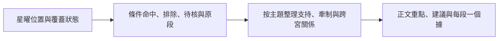

# Engine 升級計劃：由星系定位到可追查的個人分析

日期：2026-10-23。狀態：**規劃，未實作**。本輪只新增本文件，並以忽略的 tmp 腳本讀取現有 engine、重算三組既有 fixture 和探查查詢結果；不改網站、排盤、規則、文案或舊書，不 commit、push、部署。

工作基線：`C:/Users/issac/.codex/worktrees/free-ming-release/guanwei`，`codex/palace-readings`，ENGINE_VERSION 0.4.0，內容版本 `content-2026-10-23-career-context`。本輪盤點以這個開發版本為準；原始 workspace 的同名程式可能另有變更，不能靜默互換。

**建議次序：先統一現有資訊與查詢結果，再補最影響原書條件的雜曜，建立三組跨宮分析試點，最後才接寫作層。** 優先次序是按原書依賴和本專案價值排的工程次序，並非作者把星曜分成甲乙等級。

## 1. 已有能力與真正缺口

| 部分 | 已有 | 本輪確認的缺口 |
|---|---|---|
| 本命盤 | 十四主星；輔弼昌曲魁鉞、羊陀火鈴空劫；祿存天馬，共28個星曜位置；四化、宮干支、命身宮、借宮 | `palaces[].stars` 不是全部可計算星曜的完整清單，沒有逐星覆蓋狀態 |
| 額外本命函數 | `tianxingBranch()` 已算天刑；`peachStars()` 已算紅鸞、天喜、天姚、咸池 | 這5顆未統一放入宮位資料；各消費者接入不同。天刑是「已算但接入不一致」，不是完全未實作 |
| 結構 | 同宮、對宮、三方四正、相夾、空宮借星；部分府相夾局與格局 | 幾何已有，個別原書的成對、單見、眾吉、煞重、借會及例外仍需語意重核；不能把現行簡化門檻當原書完整定義 |
| 條件系統 | 通用 `condition.ts` 有三態、binding、層次、排除；`rule.ts` 有審核、版本及來源；`infer.ts` 已有支持、牽制和衝突處理 | 新宮位閱讀器另有較窄的布林 evaluator，並未全面共用同一份條件結果；通用 evaluator 的星曜覆蓋亦不完整 |
| 新宮位稿 | focused 120個 profile／29條條件規則；remaining 540個 profile／54條條件規則 | 這83條不代表全專案規則總數；部分選段最多取兩條，其他命中留在據內。屬呈現限制，不能因此認定其他證據沒有作用 |
| 時間 | 大限、流年、限流四化、疊宮、流曜、流月、小限已有模組 | 要核每項分析實際有沒有接入、使用哪套安法及來源；不能稱「運限整層未做」 |
| 廟陷與日夜 | 有現行廟陷表及出生時間處理 | 廟陷表與深造原表／正文存在版本差異；太陽時校正不等於已確認各原段的日夜判準。需分來源及判準，不一鍵換表 |

原書依據：深造 p.4 b004–b010 先星系、再宮垣干涉；p.314 b012 說明雜曜會改變組合本質。初階轉錄第3篇 p0007–p0010 反對以星曜等級代替作用判讀，並描述先建立骨架、再看修飾的次序。

### 已用只讀探針重現的兩個問題

1. 三個 fixture 的天刑，`{star:'天刑', at:[已算地支]}` 為 matched，但 `{star:'天刑', in:{name:該地支宮名}}` 為 unmatched。原因是部分入口用 helper，部分只讀 `palaces[].stars`。
2. 尚未實作的天才，`not {star:'天才', in:{name:'命宮'}}` 目前可得到 matched。這不能證明命宮沒有天才；僅證明現有資料查不到。

探針只證明條件 API 有這些行為，**未由此宣稱某篇現有正文已經判錯**。下一步應追查實際消費位置及影響範圍，而非即時修產品。

## 2. 星曜盤點與新增優先次序

以下範圍是深造雜曜章及初階轉錄第7篇相關安星口訣，不冒稱已窮盡所有流派的108星。`palaces[].stars` 沒有某星，不代表命盤實際沒有。

| 優先 | 星曜／組別 | 現況與先做工作 | 原書所支持的用途及條件 |
|---|---|---|---|
| P0 | 天刑、天姚、紅鸞、天喜、咸池 | 已有函數；統一查星及 provenance，再核安法來源。不重寫一套不同算法 | 深造315–317、321頁。刑姚要看星系、宮位；鸞喜亦不能單獨決定事件。初階07.p0126–0130、0147–0150、0163–0164 |
| P1a | 天空 | 真正未安；先補安法、再重核空庫與天機／天梁的特定同度條件 | 深造20.b005、322.b001–b008；天空、地空、旬空、截空不可合併為一粒「空」。初階07.p0117–0121 |
| P1a | 天才、華蓋、龍池、鳳閣 | 真正未安；先服務機梁／天機及命福分析 | 深造216.b007 有「明斷者」前提；318.b017–018 天才與天機同宮，見煞另論；317.b013–318.b001 龍鳳成對及其他修飾；321.b008–012 華蓋；565.b010。初階07.p0147–0150、0154–0158。不因一粒才藝星便先判明斷或擅長策劃 |
| P1a | 三台、八座、恩光、天貴、台輔、封誥 | 真正未安；服務同梁、天府及榮譽／助力的差異 | 深造87.b012–013、317.b008–011、318.b009–015、319.b008–011；台座必須成對會照，恩貴與地位／獎勵的意義分開。初階07.p0159–0162、0180–0185 |
| P1b | 天虛、陰煞、天傷 | 真正未安；完成會影響機梁／同梁分支的剩餘必要條件 | 深造87.b012、216.b007、316.b010–014、321.b005–007；機梁的部分描述先有本質前提，再要求同度。初階07.p0122–0125、0173–0179；傷使安法另有陰陽男女分支 |
| P1b | 天官、天福 | 真正未安；用於同梁與官祿／福德的具體修飾 | 深造319.b013–015：天官配天梁、天福配天同，另有宮位及整組條件；初階03.p0010、07.p0099–0103 |
| P2 | 天哭、孤辰、寡宿、大耗、天月、天巫、天廚、天壽 | 真正未安；按章別用途逐項接，不作第一輪性格總評的主軸 | 深造316、318–323頁各節。天壽等部分用法受產品既有範圍限制；不能由星名直接產出壽命／疾病結論。安法見初階07.p0104–0107、0122–0125、0131–0138、0143–0146、0154–0155、0165–0172 |
| P2 | 破碎、蜚廉、劫煞（轉錄用「劫殺」）、截空、旬空 | 真正未安；待相應宮位及時間層規則有完整卡才接 | 深造319–320、322頁；截旬空要分正／旁，不與地空天空混用。初階07.p0108–0116、0139–0142、0147–0150。劫煞需再核本命與將前系列來源，不能靠同名互代 |
| P3 | 年解、月解、天德、月德、龍德、天使；長生、博士、將前、歲前十二神 | 延後；先確認安法、系列、使用層次與可用章別 | 深造320.b008–011、322、323–325頁；初階07.p0151–0153、0165–0169、0176–0179及38–43節。這些系列不是同一星名就算同一來源；不能把生年大耗、博士大耗及流年大耗揉成一顆 |

P1是本輪目標下的先後次序，並不保證每加一粒就能新增一項個人結論。某星若只提供定位，解讀仍不足，應先保留定位而不補寫含義。

**安法與解讀分開核實：** 上述深造頁已讀相關整節及跨頁前後文，用於解讀依賴及優先次序。初階安法已查現有第7篇轉錄，但未對初階原書校勘；缺圖、疑句及版本分歧照存。未經所需驗證，不把轉錄或第三方軟件一致升格成「原書安法已核」。安法待核不由深造象義靜默補全。表內P3系列尚需實作前逐條核讀，這輪不宣稱已核完所有安法。

## 3. 判讀條件需要補到甚麼程度

| 優先 | 工作 | 具體完成標準 |
|---|---|---|
| P0 | 一個統一查星入口 | 同一位置由「宮名／地支／同度／會照／相夾」查詢一致；支援現有5個helper；輸出來源與安法版本，不再由各 reader 自己補星 |
| P0 | 逐星及逐表 coverage | 區分已計算且可查、未實作、來源待核、輸入不足；否定條件只可對完整覆蓋範圍成立。三態邏輯延伸到星曜及版本，不僅用在缺流年 |
| P0 | 統一新稿與既有條件系統 | 審視 `condition.ts`、focused／remaining evaluator 與三組專用 reader 的差異；選一份可追查結果供各層使用。已有三態、binding、格局和推理器保留重用，不另造平行 engine |
| P0 | 實坐、借安、借會分開 | 原書允許的借安關聯可以記錄，但不能整宮搬移四化、配曜、宮支；也不能把「借星」永久等同完全不可分析。每條卡指明參照層與所需實坐層 |
| P0 | 來源語意及例外 | 原段必要／否定／修飾／例外分欄；同星不同化、同度與會照、原局與經行不可互代；保留所有已成立牽制，不以吉煞相減作總分 |
| P0 | 廟陷與日夜的依據 | 先鎖定來源版本及個別原段判準。現行七檔表不直接冒稱深造六檔原表；日夜、入廟等未核時回資料不足，不由鐘面時間或另一套表代替 |
| P1 | 成對／單見／交參 | 分辨一粒、兩粒成對、同宮、會照、夾及分入兩宮。書寫「眾多」「煞重」「調和」時，不能任意指定兩粒／三粒門檻；先作分項證據，未核不定極 |
| P1 | 天府逢府看相、府庫與夾局 | 現有GEJU_DEF已有簡化定義，先對原段重核。天空覆蓋不足、百官朝拱數量門檻、露庫煞刑範圍等列為明確待審點；不因函數名已存在就當完整原書條件已成立 |
| P1 | 解除固定兩條的分析限制 | 分析結果保留全部有效、排除及待核項；正文才按重要性分配篇幅，避免同一來源重複。不是把所有命中逐句塞入文章 |
| P1 | 同一事實去重與矛盾管理 | 同一化忌、同一借星關係只算一份來源事實；保留支持、牽制和未知，不以命中條數選人格標籤 |
| P2 | 本命—大限—流年修飾 | 重用現有運限模組，為每條結論記原局基礎及新增流化／流曜；原書個案只作方法依據，不能套成樣本已發生的事件 |

例如「機梁明斷者再見天才等曜」有先後前提，不能倒轉成「見天才，所以已是明斷」。例如天府壬干化科，不能套用庚干化科的一般支持而略過武曲忌、祿存與羊陀的結構。這兩項是三組試點的必驗收分支。

## 4. 跨宮分析的順序與主語

所有跨宮連線都要有明示來源和分析目的，不能把十二宮兩兩相連當成有據分析。

| 優先 | 分析鏈 | 預期回答 | 原書入口 |
|---|---|---|---|
| P0 | 命宮星系→三方四正→相關配曜 | 同一星系內哪些差異有根據，哪些仍未能定性 | 深造4.b004–b010；同梁87–89、天府200–203、機梁215–218 |
| P1 | 命宮↔福德 | 外在處事主題與內在享受／思想活動有何不同；支持不能直接當能力評定 | 深造565.b006–566.b005，特別565.b010；具體星系再查各節 |
| P1 | 官祿↔命宮／財帛／夫妻，再連福德 | 工作內容、求財方式、合作影響與內心取向如何分開又互相修飾 | 深造4.b005；517.b002–b006。不能由事業表現推婚姻結果 |
| P1 | 財帛↔福德↔官祿；有原段需要再看田宅 | 生財、積聚、享用及經營基礎不是同一件事 | 深造429.b008–430.b009、431.b002。只在相應星系配合已核後形成個人解說 |
| P1 | 天府命宮↔天相夾局↔紫殺／借武貪 | 為甚麼不能單由天府、化科、祿存就判一個人的整體氣質 | 深造19–20、201.b001–b009；壬科、祿存羊陀與輔佐交參要分開 |
| P1 | 巨門夫妻↔命宮天梁／太陽 | 從一句「連其他宮看」進一步交代實際已知與未核的修飾 | 深造396.b007–b013、397；廟旺及其他全部前提未核，不能由太陽祿就當化解完成 |
| P2 | 僕役↔兄弟↔子女，再連命宮 | 區分一般下屬、平輩知交、親近提攜後輩；辨助力與自己承擔 | 深造503.b011–504.b003、404.b013–405；不能將全部人際都改寫成本人性格 |
| P2 | 遷移↔命宮／田宅／夫妻及相關時間層 | 分開動象、誰促成遷動、遷後處境；不由見馬就說海外得財 | 深造486–487；初階第20篇另有不同時間範圍，保留版本，不混寫 |
| P2 | 田宅↔財帛／官祿及原文指定六親 | 分清居住、經營場所、所服務機構、家族資源的主語 | 深造551–552、431.b002。不可由田宅直接給買賣回報判斷 |
| P2 | 父母↔本人命宮及日月；另分父母／上司 | 實際支持、期待和責任的主題；不把上司特質套成父母已知事實 | 深造581.b006–b011；初階第25篇角色入口另核 |
| P2 | 疾厄↔命宮／福德及運限 | 只完善傳統材料的適用條件與閱讀層次；不新增健康風險評分 | 既有引用與條件卡；具體醫療句不因資料增加而轉成個人診斷 |

兄弟、子女、父母等仍須按對象及原段逐章拆卡。本輪沒有宣稱十二宮的全部跨宮規則已覆蓋。

## 5. 三組樣本：升級後預期可多分析甚麼

下面分「現行engine已算事實」「預期增量」「仍不能判定」。**未實作星曜不在本輪試算**，不假裝已知道天才、華蓋或天空落在哪裡。

### 同梁寅申：TL

已確認：命申天同忌、天梁、火星、祿存、天馬；羊在酉、陀在未相夾。官祿子天機；財帛辰太陰、地空；福德戌太陽祿、鈴星，身宮亦在戌。現有helper天刑戌、天姚寅遷移、紅鸞酉、天喜及咸池卯。

| 增量 | 預期可以多回答 | 本盤限制 |
|---|---|---|
| 接通天刑等既有helper | 明列天刑實坐福德，不是命宮同度；命宮三方四正與另外的跨宮關聯分開，避免把「見天刑」無位置地加在人格上 | 不因天刑在福德便斷整體更有紀律，亦不能抵銷天同忌羊陀夾的已有特殊分支 |
| 原書同梁雜曜交參 | 補完恩貴、台座、台輔封誥、華蓋、虛煞等後，逐項交代哪些是本盤修飾、哪些未知，令「情趣與原則」的閱讀有具體差異 | 87–88頁特殊結構仍保留；不以一粒新增吉曜翻成調和。未算的新星不先選定方向 |
| 命—官—財—福連讀 | 比較命宮取捨、官祿天機的變動及持續經營、太陰財帛的計劃／積聚與對宮太陽祿，從而分清工作變動、資源安排和內在享用 | 522–523頁所列規劃設計能力仍有配曜／四化前提，不能先寫「你擅長分析安排」；對宮太陽祿不等於所有求財條件齊備 |
| 巨門夫妻專用跨宮卡 | 把夫妻午巨門地劫、命申同梁及太陽所在宮度列出，區分已知支持、實際牽制和未核日夜廟陷 | 太陽祿不是原文「太陽廟旺且吉」的完整替代；不由此決定婚姻結果 |

預期交付的閱讀增量：能指出「工作變動、錢的規劃、對生活的要求」各來自哪一處配置，令不同範疇的拉扯有具體來源；不再用一個同梁標籤概括全部。

### 天府巳亥：A

已確認：命亥天府壬干科、左輔、祿存，羊子／陀戌相夾；官祿卯天相、右弼、天魁；遷移巳紫微權、七殺、天鉞。財帛未空宮借丑武曲忌、貪狼、地空；該武貪實坐福德。身宮未。現有helper天刑辰僕役、紅鸞未財帛、天喜丑福德、天姚申子女、咸池酉夫妻。

| 增量 | 預期可以多回答 | 本盤限制 |
|---|---|---|
| 逢府看相及壬科完整卡 | 將天府有祿、壬科、羊陀夾與天相左右鄰宮、輔弼魁鉞逐項交代，說明守成主題如何受權力與資源結構修飾 | 輔佐「眾多」沒有任意顆數門檻；府科不直接選祥和，天相見輔亦不能替代夾局核對 |
| 天空與府庫完整性 | 補齊天空後，才能完整查原書的地空／天空同度空庫分支，分清「未見某已算因素」與「所有空庫前提均排除」 | 本輪不知道天空位置；祿存同宮不等於已排除所有空庫／露庫條件；不以未算天空當無天空 |
| 命—官—財—福分析 | 命宮管理／守成、官祿天相的權責，與福德武曲忌追求／滿足分開；財帛借武貪提供參照，但不等同財帛實坐武曲忌 | 保留原書星系結構中借武貪的參照，另記原位丑福德及借入未財帛；不可一律搬忌，也不可一律丟掉借安關係 |
| 接通5顆helper | 可指出天刑在僕役而非疾厄／福德；天喜在福德、紅鸞在空宮財帛，但不把它們當作借入武貪的同宮配曜 | 不由鸞喜保證進財，不把僕役機梁的描述改成人格判決；各配合還需原段前提 |

預期交付的閱讀增量：更具體解釋「維持資源、運用權責、追求成果、能否滿足」四件事如何分工，並展示支持與牽制，超出「天府所以保守穩重」。

### 機梁辰戌：C

已確認：命戌機梁、天梁祿、文曲、陀羅，身宮同在戌；對宮辰文昌、鈴星。財帛午天同太陰左輔；官祿寅無主星但有**本宮天馬**，借申陽巨；申本身有右弼、火星。現有helper天刑亥父母、紅鸞亥、天喜巳疾厄、天姚卯僕役、咸池酉兄弟。

| 增量 | 預期可以多回答 | 本盤限制 |
|---|---|---|
| 星系多支條件圖 | 分別追查敏感、原則、吉化、成對輔佐和煞刑的支持與牽制，展示天梁祿與科權條件的差別 | 天梁祿不是216.b005的科／權條件；吉煞同見不代表已調和 |
| 天才、華蓋、龍鳳及虛煞傷的條件 | 能在真正安入後檢查原文才藝／反應修飾，分辨實用策劃、哲理或才藝等不同分支 | 先符合各原段的本質／配星前提；未算不先說有才藝，也不能由一粒星選明斷或尖刻 |
| 官祿本宮與借星兩層 | 補充本宮天馬已存在，陽巨只在對宮作參照；將工作內容的說明、交涉與動態因素分開呈現 | 對宮火星不是官祿本宮火星；不能由天馬指定海外職業、移民或工作成就 |
| 命—財—官連讀 | 讓觀察判斷、資源處理與對外表達各有盤面依據，說明同陰及陽巨如何參與原書機梁結構 | 不把原書運限「經行」句當現在本命事件；2012年樣本仍採年少語境 |
| 已算helper的正反定位 | 明確天刑在亥父母，不符合命戌「天刑同度」；能排除這一項位置前提 | 只排除已算天刑的同度，其他未安虛煞不能順帶當沒有 |

預期交付的閱讀增量：能說明「判斷形成、資源安排、對外溝通」之間具體的配置關係；若本質仍未能定極，也能有足夠內容，而非只剩一句保留未定。

## 6. 擬議輸出與落實階段

分析資料應分開保存四層，讓寫作層消費已核結果：

建議最小欄位：`facts`（星、宮支、實坐／參照、時間層、來源）；`coverage`；`conditions`（規則版本、必要前提、排除、unknown原因、binding）；`analyses`（主題、對象、支持／牽制、可用解說範圍、原段ID）；`version`（engine、安法、來源版本、分析層、寫作層分開）。沿用既有快照及引用機制；不強制全盤分數或固定人格類型。

| 階段 | 可審閱產物 | 驗收後才做的下一步 |
|---|---|---|
| A：P0統一 | 33顆已可計算星曜的能力清單、查詢一致性及三態規格、消費差異表 | 才接通helper及修一致性；逐一核現有來源，不把計算結果宣稱為原書校勘完成 |
| B：P1a補星／條件卡 | 天空；天才華蓋龍鳳；台座恩貴台輔封誥的安法卡及原段卡 | 每組先位置測試、獨立對盤、條件反例；未完成原書校勘的安法留待核 |
| C：三組分析試點 | 每組一份「現在可知→新增可知→仍未知」分析輸出，以及命宮／骨架／一至兩個相關宮位的新舊分析對照 | 看新增分析是否有本盤差異和直接來源，不以字數變長當改善 |
| D：P1b及跨宮擴充 | 同梁、天府、機梁缺少的必要修飾補齊；逐章角色及例外卡 | 再擴到其他星系；不先全面翻寫所有正文 |
| E：寫作接入 | 本機閱讀樣稿、每段一據、對應完整原文及條件 | 另經使用者授權才改網站／開PR／發佈；本計劃不含上線授權 |
| F：P2運限／其餘雜曜 | 原局與經行差異、同名系列隔離及各章新增價值 | 本命試點穩定後另定範圍，不與本輪混做 |

不報未經拆工驗證的天數或提升分數；主要工作量在來源、條件與反例核對，並非安星函數本身。

## 7. 必要驗收與版本處理

- P0兩項探針問題必須有跨入口回歸：相同位置一致；未知星曜的否定不得 matched；組合 all／any／not 保留未知語意。
- 新增星曜不改原有28星及生年四化位置；空宮仍按有無主星定義，新增雜曜不取消借宮。檢查 helper 不重複計入。
- 按安法依賴覆蓋年干支、月日時、閏月前後半月、跨日／時辰邊界。每項安法記自己真正依賴的輸入；不照抄全部組合而不核意義。
- 用既有21張對照盤、72張預覽盤及三個fixture作位置／來源回歸；軟件一致是對照證據，不能代替原書安法校勘。另設同度改會照、缺成對星、借入四化、命中例外與缺輸入等反例。
- 每條支持與牽制保留原段定位及完整前後文；先重核變更影響的舊規則，不只刷新語意審核指紋。
- 三組試點各要能回答本章明確問題，並交代新增資料如何改變或維持解讀。不要求每盤一定新增結論；「排除一個不適用分支」亦是有用成果。
- 輸出或預設安法有變，依專案規則升 engine／school profile 版本；條件與分析另記版本。**舊盤、舊書不靜默重排重寫**，新輸出先以獨立試點結果對照。
- 維持既有產品對象與風險範圍；不將分析層擴充變成新的人格、疾病、存亡或事件機率評分。新增資料用於更細的條件與解讀，不自動放寬原有結論資格。

## 8. 本輪來源與證據狀態

深造來源：本機595頁PDF，SHA256 `513e3d068040efe3684eb3c0e44cf6e447787670bbf5d618f022da2d6c55231b`。原書全文與抽取正文只在忽略的 tmp，本文只記自寫摘要及定位。

已讀：p.4、19–20；`deep.system.17/55/60`整節；`deep.misc.intro`、01–26（含huagai）相關整節及跨頁；財帛429–433、事業516–519／天機522–525、巨門夫妻396–397、福德565–566／武曲571–572／貪狼576、遷移486–487、僕役503–504、子女404–405、田宅551–552、父母580–582的相關整節。華蓋標題等原檔疑字依現有來源註記保留；原書強烈事件句並未因此轉成個人輸出規則。

初階來源：現有第三方轉錄；已讀第3篇前言完整段、第7篇相關安星口訣99–185及段落導航。篇號及抽取段號不是原書頁碼；第7篇四化差異、缺圖及疑句保留，不用此轉錄覆蓋專案已選四化表。

可復查只讀盤點（原始workspace忽略檔）：`tmp/engine-upgrade-inventory.ts`、`tmp/engine-upgrade-inventory.json`、`tmp/engine-upgrade-diagnostic.json`。其中33顆僅表示現行程式能提供28+5個本命位置，不表示全部安法已獲原書校勘。

本輪未實作新星、未修改任何產品檔案，故沒有宣稱engine升級測試已通過；已做的是現行fixture重算、API探針、原節查閱及規劃文件一致性核對。
